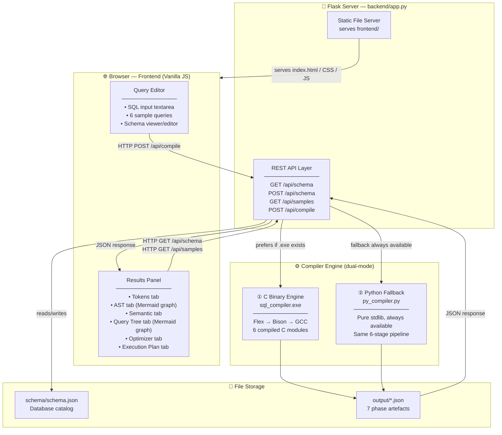
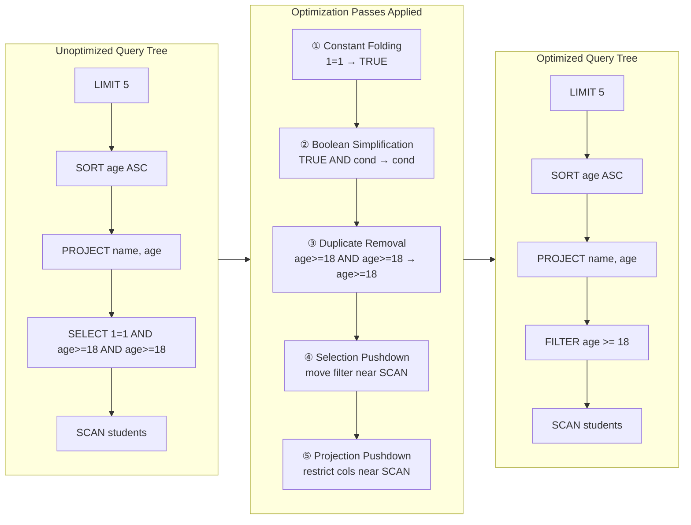

<div align="center">

# SQL Query Compiler Studio

**A full-stack, interactive SQL compiler that takes a raw query through every classical compiler phase — from tokenisation to physical execution planning — and visualises each stage in real time.**

[](https://python.org)
[](https://flask.palletsprojects.com)
[](https://en.wikipedia.org/wiki/ANSI_C)
[](https://github.com/westes/flex)
[](https://www.gnu.org/software/bison/)
[](LICENSE)

</div>

---

## What Is This Project?

When you type a SQL query into a real database like PostgreSQL or MySQL, the engine does **far more** than just "look up a table." It runs the query through a multi-stage **compiler** — the same kind used for programming languages — before a single row is read from disk.

**SQL Query Compiler Studio** makes this invisible process **visible and interactive**. You type a SQL `SELECT` statement into the browser, hit **Compile**, and the app walks you through every internal stage:

| Stage | What happens |
|---|---|
| **Lexical Analysis** | The raw text is broken into typed tokens (keywords, identifiers, literals, operators) |
| **Syntax Analysis** | Tokens are matched against SQL grammar rules to build an **Abstract Syntax Tree (AST)** |
| **Semantic Analysis** | The AST is validated against a live schema — wrong table names, missing columns, and duplicates are caught here |
| **Query Tree** | The validated AST is translated into a **Relational Algebra tree** (σ, π, τ operators) |
| **Query Optimizer** | The tree is rewritten using classical optimisation rules — constant folding, predicate pushdown, duplicate removal |
| **Execution Plan** | A physical pipeline of operators is emitted alongside **pseudo-bytecode** with complexity estimates |

Each stage produces a JSON artefact that is displayed side-by-side in the browser with syntax highlighting and interactive **Mermaid.js** graph renders.

### Why is this useful?

- **Students** learning compiler construction or database internals can see exactly what a SQL engine does under the hood.
- **Developers** can inspect how a query is optimised and what physical operators it maps to.
- **Educators** can use the 6 built-in sample queries to demonstrate specific concepts — constant folding, semantic errors, duplicate warnings, etc.

### Dual-Engine Design

The compiler engine runs in two modes without any configuration:

1. **C Binary Engine** — a native `sql_compiler.exe` compiled from Flex/Bison/GCC sources (`lexer.l`, `parser.y`, and six C modules). Used automatically when the binary exists.
2. **Python Fallback Engine** — a pure-Python implementation (`py_compiler.py`) that reproduces all 6 stages using only the Python standard library. Works on every machine with Python installed, no MSYS2 or GCC needed.

---

## System Architecture



---

## Compiler Pipeline

The pipeline is a linear chain — each stage reads the previous stage's output and writes its own JSON artefact.

```mermaid
flowchart TD
    INPUT(["📝 SQL Query String\ne.g. SELECT name FROM students\nWHERE age >= 18 LIMIT 5"])

    S1["🔤 Stage 1 · Lexical Analysis\n━━━━━━━━━━━━━━━━━━━━━━━━━━━\nFlex regex rules / py_compiler.py\n\nBreaks query into typed tokens:\n• KEYWORD  →  SELECT FROM WHERE ORDER BY LIMIT ASC DESC\n• IDENTIFIER  →  table and column names\n• INT_LITERAL / FLOAT_LITERAL / STRING_LITERAL\n• BOOL_LITERAL  →  TRUE / FALSE\n• OPERATOR  →  = != < > <= >=\n• DELIMITER  →  , ; * ( )\nTracks line + column for each token"]

    OUT1[/"output/tokens.json"/]

    S2["🌳 Stage 2 · Syntax Analysis\n━━━━━━━━━━━━━━━━━━━━━━━━━━━\nBison grammar rules / py_compiler.py\n\nBuilds Abstract Syntax Tree:\n• SELECT_STMT  (root node)\n  ├─ COLUMN_LIST  or  STAR\n  ├─ TABLE_NAME\n  ├─ WHERE_CLAUSE\n  │    └─ BINARY_EXPR (AND/OR/rel-op)\n  ├─ ORDER_BY_CLAUSE\n  └─ LIMIT_CLAUSE"]

    OUT2[/"output/ast.json"/]

    S3["✅ Stage 3 · Semantic Analysis\n━━━━━━━━━━━━━━━━━━━━━━━━━━━\nsemantic.c / py_compiler.py\n\nLoads schema.json as a symbol table\nValidates:\n  ✓  Table exists in catalog\n  ✓  Every projected column exists\n  ✓  ORDER BY column exists\nWarnings raised:\n  ⚠  Duplicate SELECT columns\n  ⚠  Redundant WHERE conditions"]

    OUT3[/"output/semantic.json"/]

    S4["📐 Stage 4 · Query Tree\n━━━━━━━━━━━━━━━━━━━━━━━━━━━\nquery_tree.c / py_compiler.py\n\nTranslates AST → Relational Algebra tree:\n  LIMIT  →  L\n  SORT   →  τ (ORDER BY)\n  PROJECT→  π (SELECT columns)\n  SELECT →  σ (WHERE predicate)\n  SCAN   →  ⊞ (full table access)"]

    OUT4[/"output/query_tree.json"/]

    S5["⚡ Stage 5 · Query Optimizer\n━━━━━━━━━━━━━━━━━━━━━━━━━━━\noptimizer.c / py_compiler.py\n\nOptimization passes (bottom-up AST walk):\n  • Constant Folding       1=1 → TRUE\n  • Boolean Simplification TRUE AND cond → cond\n  • Duplicate Removal      age>18 AND age>18 → age>18\n  • Selection Pushdown     move σ close to SCAN\n  • Projection Pushdown    restrict columns early"]

    OUT5[/"output/optimized.json"/]

    S6["🚀 Stage 6 · Physical Execution Plan\n━━━━━━━━━━━━━━━━━━━━━━━━━━━\nexecution_plan.c / py_compiler.py\n\nPhysical operator pipeline:\n  TABLE SCAN  cost O(N)\n  FILTER      cost O(N)\n  PROJECT     cost O(K)\n  ORDER BY    cost O(K log K)\n  LIMIT       cost O(1)\n\nPseudo-bytecode emitted:\n  SCAN students\n  FILTER age >= 18\n  PROJECT name\n  LIMIT 5\n  RETURN"]

    OUT6[/"output/execution_plan.json"/]

    INPUT --> S1 --> OUT1 --> S2 --> OUT2 --> S3 --> OUT3
    S3 -- "error → stop" --> ERR(["❌ Error Response\nreturned to UI"])
    OUT3 --> S4 --> OUT4 --> S5 --> OUT5 --> S6 --> OUT6
```



---

## Optimization Passes — Detail



---

## Tech Stack

| Layer | Technology | Details |
|---|---|---|
| **Compiler — Primary** | ANSI C99 · Flex · GNU Bison · GCC | 6 C modules compiled to `sql_compiler.exe` via `build.bat` / `Makefile` |
| **Compiler — Fallback** | Python 3 (stdlib only) | `py_compiler.py` — identical 6-stage pipeline, zero extra dependencies |
| **Backend API** | Python Flask 3.x | REST endpoints + static file server for the frontend |
| **Frontend** | Vanilla HTML5 · CSS3 · JavaScript ES2020 | Single-page app, no framework, no bundler |
| **Graph Rendering** | Mermaid.js (CDN) | AST and Query Tree rendered as interactive node graphs |
| **Database Catalog** | JSON (`schema/schema.json`) | Editable at runtime via the UI or directly |

---

## Project Structure

```
sql-query-compiler-studio/
│
├── backend/
│   ├── app.py                   ← Flask server: REST API + serves frontend/
│   └── compiler/
│       ├── lexer.l              ← Flex lexer grammar — SQL token rules
│       ├── parser.y             ← Bison parser grammar — SQL SELECT grammar
│       ├── main.c               ← C binary entry point
│       ├── ast.c / ast.h        ← AST node types, allocation, JSON serialiser
│       ├── token.c / token.h    ← Token structs and type-name lookup
│       ├── symbol_table.c/.h    ← Schema catalog loader and symbol resolver
│       ├── semantic.c/.h        ← Semantic checker, error/warning collector
│       ├── query_tree.c/.h      ← Relational algebra tree builder
│       ├── optimizer.c/.h       ← 5 optimisation passes (bottom-up AST walk)
│       ├── execution_plan.c/.h  ← Physical operator pipeline + bytecode emitter
│       ├── py_compiler.py       ← Pure-Python fallback compiler (all 6 stages)
│       ├── test_compile.py      ← Unit tests for the Python compiler
│       ├── build.bat            ← Windows: flex → bison → gcc → sql_compiler.exe
│       └── Makefile             ← Linux/macOS equivalent
│
├── frontend/
│   ├── index.html               ← SPA shell: editor + tabbed results panel
│   ├── css/style.css            ← Dark glassmorphism theme, animations
│   └── js/app.js                ← All UI logic, API calls, Mermaid.js rendering
│
├── schema/
│   └── schema.json              ← Live DB catalog: tables, column types, sample rows
│
├── output/                      ← Auto-generated per compile (git-ignored)
│   ├── query.sql                ← Last submitted query
│   ├── tokens.json
│   ├── ast.json
│   ├── semantic.json
│   ├── query_tree.json
│   ├── optimized.json
│   └── execution_plan.json
│
├── package.json                 ← "npm run dev" → python backend/app.py
├── requirements.txt             ← flask>=3.0.0
├── start.bat                    ← Windows one-click: install deps + launch
└── README.md
```

---

## Database Schema

Ships with **3 tables** in `schema/schema.json`. The schema can be edited live in the browser UI — changes are persisted via `POST /api/schema`.

| Table | Columns | Types |
|---|---|---|
| `students` | `id`, `name`, `age`, `gpa`, `is_active` | INT, VARCHAR, INT, FLOAT, BOOLEAN |
| `employees` | `id`, `name`, `salary`, `department`, `is_active` | INT, VARCHAR, FLOAT, VARCHAR, BOOLEAN |
| `courses` | `course_id`, `title`, `credits` | INT, VARCHAR, INT |

---

## Quick Start

### Prerequisites

| Requirement | Purpose | Required? |
|---|---|---|
| Python 3.8+ | Flask server + Python compiler engine | **Yes** |
| Node.js / npm | Enables `npm run dev` shortcut | Optional |
| MSYS2 + GCC + Flex + Bison | Build the native C binary engine | Optional |

### Run (pick any one)

```powershell
# Option 1 — npm shortcut
npm run dev

# Option 2 — Python directly
python backend/app.py

# Option 3 — Windows one-click batch (auto-installs deps)
start.bat

# Option 4 — Explicit setup
pip install -r requirements.txt
python backend/app.py
```

Then open **http://localhost:5000** in your browser.

---

## Build the C Compiler Engine (Optional)

The Python fallback works out of the box. To compile and use the native C engine:

**Windows — MSYS2 UCRT64**

```bat
cd backend\compiler
build.bat
```

**Linux / macOS**

```bash
cd backend/compiler
make
```

Flask auto-detects `sql_compiler.exe` at startup and prefers it over the Python fallback.

---

## REST API Reference

| Method | Endpoint | Description |
|---|---|---|
| `GET` | `/` | Serves `frontend/index.html` |
| `GET` | `/api/schema` | Returns the current database schema |
| `POST` | `/api/schema` | Saves an updated schema to `schema.json` |
| `GET` | `/api/samples` | Returns 6 built-in example queries |
| `POST` | `/api/compile` | Runs the full compiler pipeline and returns all phase outputs |

**Compile — Request**

```json
POST /api/compile
Content-Type: application/json

{
  "query": "SELECT name, age FROM students WHERE age >= 18 ORDER BY age ASC LIMIT 5;"
}
```

**Compile — Response**

```json
{
  "success": true,
  "engine": "Python SQL Compiler Engine",
  "tokens": [
    { "type": "KEYWORD",    "value": "SELECT", "line": 1, "column": 1 },
    { "type": "IDENTIFIER", "value": "name",   "line": 1, "column": 8 }
  ],
  "ast": {
    "type": "SELECT_STMT",
    "children": [ "COLUMN_LIST", "TABLE_NAME", "WHERE_CLAUSE", "ORDER_BY_CLAUSE", "LIMIT_CLAUSE" ]
  },
  "semantic": {
    "success": true,
    "errors": [],
    "warnings": [],
    "symbol_table": { "table": "students", "columns": [{ "name": "age", "type": "INT" }] }
  },
  "query_tree":   { "type": "LIMIT", "value": "5", "child": { "type": "SORT", "..." : "..." } },
  "optimized":    { "rules_applied": ["Selection Pushdown", "Projection Pushdown"], "optimized_tree": {} },
  "execution_plan": {
    "operators": [
      { "step": 1, "op": "TABLE SCAN", "details": "Table: students",  "cost": "O(N)"       },
      { "step": 2, "op": "FILTER",     "details": "age >= 18",        "cost": "O(N)"       },
      { "step": 3, "op": "PROJECT",    "details": "name, age",        "cost": "O(K)"       },
      { "step": 4, "op": "ORDER BY",   "details": "age ASC",          "cost": "O(K log K)" },
      { "step": 5, "op": "LIMIT",      "details": "Max Tuples: 5",    "cost": "O(1)"       }
    ],
    "bytecode": ["SCAN students", "FILTER age >= 18", "PROJECT name, age", "SORT age ASC", "LIMIT 5", "RETURN"]
  }
}
```

---

## Built-in Sample Queries

| # | Query | Demonstrates |
|---|---|---|
| 1 | `SELECT id, name, age FROM students WHERE age >= 18 ORDER BY age ASC LIMIT 10` | Full pipeline — all 6 stages |
| 2 | `SELECT name, gpa FROM students WHERE 1 = 1 AND age > 20 ORDER BY gpa DESC LIMIT 5` | Constant Folding + Boolean Simplification |
| 3 | `SELECT name, name, age FROM students WHERE age > 18 AND age > 18` | Duplicate column and condition warnings |
| 4 | `SELECT unknown_col, name FROM students WHERE age > 20` | Semantic error — column not found |
| 5 | `SELECT id, title FROM non_existing_table` | Semantic error — table not found |
| 6 | `SELECT name, salary, department FROM employees WHERE salary > 50000 ORDER BY salary DESC LIMIT 3` | Multi-column, multi-type query |

---

## Output Files

Each `/api/compile` call writes (and returns) these files from `output/`:

| File | Contents |
|---|---|
| `query.sql` | Raw SQL string submitted for compilation |
| `tokens.json` | Token array — `type`, `value`, `line`, `column` per token |
| `ast.json` | Full Abstract Syntax Tree as nested JSON |
| `semantic.json` | `success`, `errors[]`, `warnings[]`, resolved `symbol_table` |
| `query_tree.json` | Unoptimized relational algebra tree |
| `optimized.json` | `rules_applied[]` list + the rewritten optimized tree |
| `execution_plan.json` | `operators[]` with cost estimates + `bytecode[]` array |

---

## Running Tests

```powershell
python backend/compiler/test_compile.py
```

---

## License

MIT — Built as a Compiler Construction course project.
